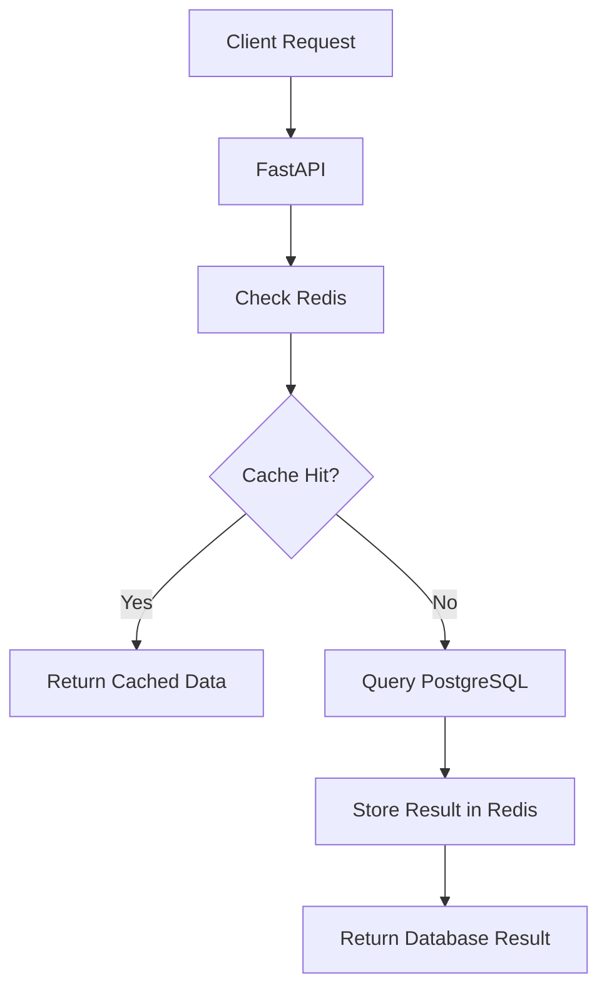
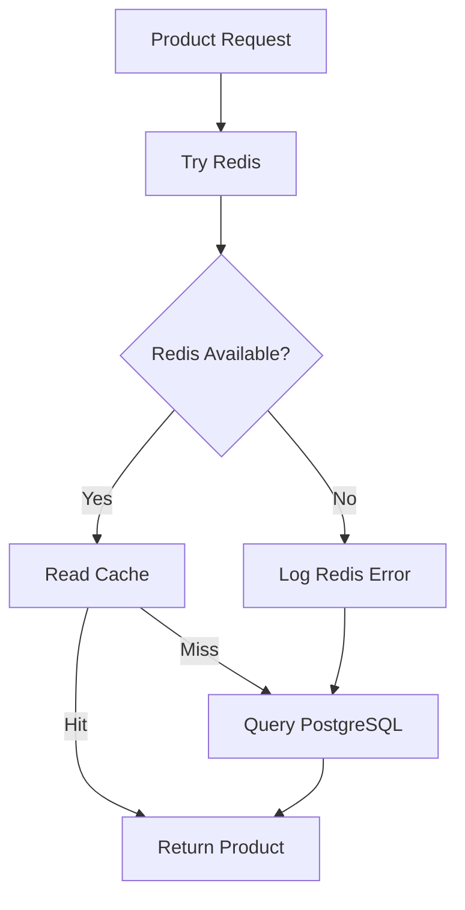

# Day 5 — Redis Integration and Product Caching

**Status:** Completed  
**Date:** 18 November 2026  
**Technology:** Redis 7, redis-py 8.1.0  
**Application:** FastAPI + SQLAlchemy + PostgreSQL

---

## 1. Day 5 Objectives

The objective of Day 5 was to integrate Redis into the existing e-commerce backend and implement caching for product-related API operations.

Before Redis, every product request required the application to query PostgreSQL.

This introduced unnecessary database reads for frequently accessed product information.

We introduced Redis as a caching layer to reduce repeated database queries and improve read performance.

### Objectives completed

- Integrate Redis with Docker Compose.
- Connect Redis to the FastAPI application.
- Manage Redis client lifecycle through FastAPI lifespan.
- Implement product detail caching.
- Implement product-list caching.
- Implement cache-aside strategy.
- Implement cache expiration using TTL.
- Implement cache invalidation after product mutations.
- Add Redis health-check endpoint.
- Handle Redis failures gracefully.
- Verify cache behavior through API requests and application logs.

---

## 2. What Is Redis?

Redis is an in-memory data store commonly used for caching, temporary data storage, counters, queues, and distributed coordination.

Unlike PostgreSQL, which primarily stores transactional data on persistent storage, Redis keeps frequently accessed data in memory for fast retrieval.

### Why do we need Redis?

Consider a product endpoint:

`GET /api/v1/products/123`

Without caching:

1. Client sends a request.
2. FastAPI receives the request.
3. Product service queries PostgreSQL.
4. PostgreSQL returns the product.
5. FastAPI sends the response.

If 1,000 clients request the same product, the application may perform 1,000 database reads.

With Redis caching:

1. Client sends a request.
2. FastAPI checks Redis.
3. If the product exists in Redis, return it.
4. Otherwise, query PostgreSQL.
5. Store the result in Redis.
6. Return the response.

Repeated requests can now be served directly from Redis.

### What problem does Redis solve?

- Reduces repeated database queries.
- Reduces PostgreSQL read pressure.
- Improves response time for frequently accessed data.
- Helps applications handle higher read traffic.

### Trade-offs

- Cached data can become stale.
- Cache invalidation adds complexity.
- Redis requires additional infrastructure.
- Memory is limited and must be managed.
- Cache misses can increase database traffic.
- Cache failures require a fallback strategy.

**Important:** PostgreSQL remains the source of truth. Redis is only a performance optimization for our product reads.

---

## 3. Redis Docker Configuration

Redis was added to the existing Docker Compose configuration.

### Configuration

The Redis container uses:

- Image: `redis:7-alpine`
- Port: `6379`
- AOF persistence enabled.
- Persistent Docker volume: `redis_data`.
- Health check using `redis-cli ping`.

The persistent volume allows Redis data to survive container replacement, subject to Redis persistence and recovery behavior.

### Redis connection

The application connects through an environment-driven URL:

`REDIS_URL=redis://localhost:6379/0`

For Docker-based application deployments, the hostname should use the Redis Compose service name instead of `localhost`.

### Verify Redis

Check container status:

```bash
docker compose ps
```

Test the Redis connection:

```bash
docker compose exec redis redis-cli PING
```

Expected response:

```text
PONG
```

---

## 4. Redis Client Integration

Redis client creation is handled in:

`src/core/redis.py`

The application uses the synchronous Redis Python client because the existing product service and SQLAlchemy database operations are synchronous.

### Implementation

```python
import os

from redis import Redis


REDIS_URL = os.getenv(
    "REDIS_URL",
    "redis://localhost:6379/0"
)


def create_redis_client() -> Redis:
    return Redis.from_url(
        REDIS_URL,
        decode_responses=True
    )


def close_redis_client(client: Redis) -> None:
    client.close()
```

### Why decode_responses=True?

Redis stores values as bytes by default.

Setting `decode_responses=True` makes the client return string values, simplifying JSON serialization and deserialization.

### FastAPI lifecycle integration

The Redis client is initialized during FastAPI startup and stored in application state.

Conceptually:

```python
redis_client = create_redis_client()
app.state.redis = redis_client
```

During shutdown:

```python
close_redis_client(redis_client)
```

This allows application services to access the shared Redis client without creating a new connection for every request.

---

## 5. Cache Strategy — Cache-Aside

We implemented the **Cache-Aside Pattern**.

In this pattern, the application is responsible for checking the cache and populating it when necessary.

### Cache flow



### Cache HIT

A cache hit occurs when the requested information already exists in Redis.

The application returns the cached result without querying PostgreSQL.

### Cache MISS

A cache miss occurs when the requested information does not exist in Redis.

The application:

1. Queries PostgreSQL.
2. Converts the database result into the required response format.
3. Stores the result in Redis.
4. Returns the result.

---

## 6. Product Detail Caching

**File:** `src/services/product_service.py`

We implemented caching for:

`GET /api/v1/products/{product_id}`

### Cache key

```text
product:{product_id}
```

Example:

```text
product:299c7a93-b318-4e04-bb00-703400ba8c37
```

### Cache expiration

The application uses a shared TTL constant:

```python
PRODUCT_CACHE_TTL = 300
```

This represents 300 seconds, or 5 minutes.

The Redis entry is stored using expiration-aware storage (`SETEX`).

### Request behavior

**First request:**

```text
Redis GET
    |
    v
Cache MISS
    |
    v
Query PostgreSQL
    |
    v
Store product in Redis
    |
    v
Return product
```

**Subsequent request:**

```text
Redis GET
    |
    v
Cache HIT
    |
    v
Return cached product
```

### Logging

The service logs cache behavior:

```text
Product cache MISS: <product_id>
Product cached: <product_id>
Product cache HIT: <product_id>
```

These logs helped us verify that Redis was being used correctly.

---

## 7. Product-List Caching

We also implemented caching for:

`GET /api/v1/products`

Product-list responses can contain different results depending on pagination, search, filtering, and sorting.

Therefore, we cannot use one fixed cache key for every product-list request.

### Cache key generation

We generate a unique cache key using the request parameters.

The parameters include:

- `skip`
- `limit`
- `search`
- `min_price`
- `max_price`
- `sort_by`
- `sort_order`

The service:

1. Builds a dictionary containing the request parameters.
2. Serializes it using sorted JSON keys.
3. Generates a SHA-256 hash.
4. Uses that hash as part of the Redis key.

### Cache key format

```text
products:list:{sha256_hash}
```

Example:

```text
products:list:f53be19c437d48ae6378fbcbda4030509ca6f99c8c899b873ca6d0c15a69f1d5
```

### Why generate a hash?

Different combinations of pagination and filters must produce different cache entries.

For example:

```text
GET /api/v1/products?skip=0&limit=10
```

and

```text
GET /api/v1/products?skip=0&limit=5
```

must not return the same cached response.

Hashing gives us a predictable and compact cache key.

### Cached response structure

The list response contains:

```json
{
  "total": 6,
  "skip": 0,
  "limit": 10,
  "products": [
    {
      "id": "product-uuid",
      "name": "Example Product",
      "description": "Example description",
      "price": "1000.00",
      "is_active": true
    }
  ]
}
```

The actual product list is serialized as JSON before being stored in Redis.

### Logging

```text
Product list cache MISS: products:list:<hash>
Product list cached: products:list:<hash>
Product list cache HIT: products:list:<hash>
```

---

## 8. Cache Invalidation

Caching creates a consistency problem.

Suppose a product is cached with a price of ₹1,000.

The product is then updated in PostgreSQL to ₹1,500.

If Redis still contains the old value, clients may continue receiving ₹1,000.

To prevent this, we implemented cache invalidation.

### 8.1 Product creation

When a product is created:

1. Save the product in PostgreSQL.
2. Invalidate cached product-list entries.
3. The next list request fetches fresh data from PostgreSQL.

There is no individual product cache to invalidate for a newly created product.

### 8.2 Product update

When a product is updated:

1. Update PostgreSQL.
2. Delete the individual product cache.
3. Invalidate product-list caches.
4. The next request fetches the updated product.

### 8.3 Product deletion

When a product is deleted:

1. Perform the product deletion operation in PostgreSQL.
2. Delete the individual product cache.
3. Invalidate product-list caches.

Our product deletion behavior uses the existing soft-delete implementation.

### 8.4 Product-list invalidation

Product-list cache keys contain generated hashes.

We therefore cannot know every existing list key in advance.

We use Redis `SCAN` to find keys matching:

```text
products:list:*
```

Matching keys are deleted using Redis `DEL`.

**Why SCAN instead of KEYS?**

`KEYS` can block Redis while scanning a large keyspace.

`SCAN` iterates incrementally and is generally safer for application-side key discovery.

However, `SCAN` is not an atomic snapshot. Concurrent cache creation can make invalidation more complicated. Our current approach is suitable for this project stage, but a versioned cache-key strategy could be considered later.

---

## 9. Redis Failure Handling

Redis is an optimization, not a critical dependency for reading product data.

If Redis becomes unavailable, product reads should continue using PostgreSQL.

### Expected failure behavior



### Redis read failure

If Redis GET fails:

- Log the error.
- Continue to PostgreSQL.
- Return the database result.

### Redis write failure

If Redis SETEX fails:

- Log the error.
- Do not fail the product request.
- Return the PostgreSQL result.

### Redis invalidation failure

If cache invalidation fails, the application logs the error rather than failing the successful database mutation.

One consequence is that stale cached data may remain until its TTL expires.

This is an important trade-off in the current implementation.

---

## 10. Redis Health Check

**File:** `src/api/health.py`

We added:

```text
GET /health/redis
```

The endpoint checks Redis connectivity using:

```python
redis_client.ping()
```

Expected behavior:

| Redis state | HTTP response |
|---|---|
| Redis available | 200 OK |
| Redis unavailable | 503 Service Unavailable |

The health endpoint provides a simple way to inspect Redis availability independently of the main application health endpoint.

---

## 11. Testing and Verification

We verified Redis behavior through actual API requests and application logs.

### Test 1 — Redis connection

Command:

```bash
docker compose exec redis redis-cli PING
```

Expected:

```text
PONG
```

**Result:** Passed.

### Test 2 — Product detail cache MISS

First request:

```text
GET /api/v1/products/{product_id}
```

Observed:

```text
Product cache MISS
Product cached
```

**Result:** Passed.

### Test 3 — Product detail cache HIT

Repeated the same GET request.

Observed:

```text
Product cache HIT
```

**Result:** Passed.

### Test 4 — Product-list cache MISS and HIT

First request:

```text
GET /api/v1/products?skip=0&limit=10&sort_by=created_at&sort_order=desc
```

Observed:

```text
Product list cache MISS
Product list cached
```

Repeated the same request.

Observed:

```text
Product list cache HIT
```

**Result:** Passed.

### Test 5 — Different pagination parameters

Changed the limit from 10 to 5.

Observed:

- A different cache key was generated.
- The request resulted in a cache MISS.
- A separate cache entry was created.

**Result:** Passed.

### Test 6 — Product creation invalidation

Created a product:

```json
{
  "name": "Temp-Product",
  "description": "Testing invalidate list",
  "price": 255155
}
```

Observed:

```text
Product list cache invalidated
```

The next product-list request resulted in a cache MISS and returned the newly created product.

**Result:** Passed.

### Test 7 — Product update invalidation

Updated the product name and price.

Observed:

```text
Product cache invalidated: <product_id>
Product list cache invalidated
```

The subsequent product detail request resulted in a cache MISS and cached the updated product.

**Result:** Passed.

### Test 8 — Cache expiration

Temporarily changed the TTL to 10 seconds:

```python
PRODUCT_CACHE_TTL = 10
```

Observed behavior:

```text
16:04:23 - Product cache MISS
16:04:23 - Product cached

16:04:30 - Product cache HIT

16:04:33 - Product cache MISS
16:04:33 - Product cached
```

This demonstrated that:

- The first request populated Redis.
- A request within the TTL used the cache.
- A request after expiration fetched fresh data and recreated the cache entry.

After the experiment, the TTL was restored to:

```python
PRODUCT_CACHE_TTL = 300
```

**Result:** Passed.

### Test 9 — Redis unavailable

Stopped Redis and requested product information.

Observed that Redis operations failed, but the application continued using PostgreSQL and returned the product successfully.

**Result:** Passed.

### Test 10 — Redis recovery

Restarted Redis and verified that the application could use Redis again.

**Result:** Passed.

### Test 11 — Product deletion invalidation

Verified product detail and product-list cache invalidation after product deletion.

**Result:** Passed.

---

## 12. Logging and Observability

We used application logs to inspect cache behavior.

Important events include:

| Log event | Meaning |
|---|---|
| Product cache HIT | Product served from Redis |
| Product cache MISS | Product not found in Redis |
| Product cached | Product stored in Redis |
| Product cache invalidated | Individual cache removed |
| Product list cache HIT | Product list served from Redis |
| Product list cache MISS | Product list not found in Redis |
| Product list cached | Product list stored in Redis |
| Product list cache invalidated | Product-list keys removed |
| Redis operation error | Redis operation failed |

### Future monitoring improvements

The current implementation uses logs and a health endpoint.

We have not yet implemented dedicated Prometheus cache metrics.

Potential metrics to add later:

- Cache hit rate.
- Cache miss rate.
- Redis operation latency.
- Redis connection errors.
- Redis memory usage.
- Eviction count.
- Product API p95 and p99 latency.

A useful cache hit-rate formula is:

```text
Cache Hit Rate = Cache Hits / (Cache Hits + Cache Misses) × 100
```

A higher hit rate can indicate effective caching, but it should be evaluated alongside correctness and latency.

---

## 13. Current Limitations and Future Improvements

The current Redis implementation is intentionally focused on product caching.

Potential future improvements include:

1. Cache stampede prevention.
2. Versioned cache keys for more reliable list invalidation.
3. Negative caching for frequently requested missing products.
4. Cache warming for popular products.
5. Dedicated Redis metrics through Prometheus.
6. Redis authentication and production network security.
7. Redis memory policies and capacity planning.
8. Redis high availability and replication.
9. Load testing with cached and uncached requests.
10. Distributed rate limiting.

These are future enhancements, not blockers for the current product-caching milestone.

---

## 14. Architecture Decisions

| Decision | Reason |
|---|---|
| Redis for product caching | Reduce repeated PostgreSQL reads |
| PostgreSQL remains source of truth | Preserve transactional correctness |
| Cache-aside pattern | Application controls cache reads and population |
| 300-second TTL | Limit how long cached data remains valid |
| SHA-256 list cache keys | Separate different filter and pagination combinations |
| Invalidate after mutations | Reduce stale product data |
| SCAN for list-key discovery | Avoid blocking keyspace scans with KEYS |
| Synchronous Redis client | Align with existing synchronous SQLAlchemy and product service |
| PostgreSQL fallback | Keep product reads available during Redis outages |

---

## 15. Day 5 Completion Summary

**Day 5 Redis integration is complete for the current roadmap stage.**

Implemented:

- Redis Docker integration.
- Redis Python client.
- FastAPI Redis lifecycle management.
- Redis health endpoint.
- Product detail cache.
- Product-list cache.
- Cache-aside strategy.
- TTL expiration.
- Product create/update/delete invalidation.
- Redis failure fallback to PostgreSQL.

Verified:

- Redis connectivity.
- Cache MISS and HIT.
- Different cache keys for different pagination parameters.
- Product creation invalidation.
- Product update invalidation.
- Product deletion invalidation.
- Cache expiration.
- PostgreSQL fallback.
- Redis recovery after restart.

### Next milestone — Day 6: RabbitMQ

The next technology in our roadmap is RabbitMQ.

Before implementation, we will study:

1. What RabbitMQ is.
2. Why it exists.
3. What problem it solves.
4. Its trade-offs.
5. What happens when it fails.
6. How to measure its performance and reliability.

We will then decide how it fits alongside Kafka in our e-commerce architecture.

---

**Day 5 complete: Redis product caching integrated, tested, and documented.**